# QKernel-Lite: Empirical Evaluation of Projected Quantum Kernels on Clinical Scarcity

**Team: Dirac's Army**  
Daksh Singh (2024BCS0042) · Anshuman Biswas (2024BCD0008) · Himmat Sirwee (2024BCS0040) · Sawan Kumar (2024BCS0164) · Aryan Gupta (2024BCS0020)  
*Indian Institute of Information Technology (IIIT)*

### Live Deployments
- **Interactive Research Platform**: [https://qkernel-lite.duckdns.org/](https://qkernel-lite.duckdns.org/)
- **10-Page Formal Academic Report (PDF / HTML)**: [https://qkernel-lite.duckdns.org/report/](https://qkernel-lite.duckdns.org/report/)
- **Presentation Slide Deck**: [https://qkernel-lite.duckdns.org/slides/](https://qkernel-lite.duckdns.org/slides/)
- **Interactive Architecture Diagram**: [https://qkernel-lite.duckdns.org/report/architecture.html](https://qkernel-lite.duckdns.org/report/architecture.html)

### Repository Structure & Key Artifacts
- **Academic Report Source**: [`report/index.html`](report/index.html) (1-to-1 physical A4 print styling)
- **Interactive Architecture**: [`report/architecture.html`](report/architecture.html) · [Vector SVG](report/images/architecture.svg)
- **Presentation Slide Deck**: [`slides/index.html`](slides/index.html) (Self-contained HTML5 presentation)
- **Streamlit Platform Engine**: [`app.py`](app.py) (Interactive dashboard with precomputed evaluation cache)
- **Deployment Guide**: [`deploy/DEPLOYMENT_GUIDE.md`](deploy/DEPLOYMENT_GUIDE.md) (Oracle Cloud Always-Free VM setup)

---

## Abstract & Research Overview

Projected Quantum Kernels (PQK; Huang et al., 2021) project high-dimensional quantum states back to reduced 1-particle physical observables, mitigating the exponential fidelity concentration problem inherent in conventional quantum kernel methods. Recent studies (Alagiyawanna et al., 2024/2026) proposed angle-encoded PQKs with classical convolutional feature extractors for medical image classification under extreme training data scarcity ($N \le 100$).

This repository provides an empirical benchmark evaluating whether projected quantum kernels provide an inductive bias advantage over classical kernel methods when trained on small subsets of pediatric chest radiographs (`PneumoniaMNIST`). Across 960 independent runs over 15 random seeds ($n = 15$, df = 14) with paired Student's t-tests and family-wise Bonferroni correction ($\alpha_{\text{bonf}} = 0.05 / 12 \approx 0.00417$), we evaluate four model classes under identical feature representations:

1. **Model M1 (Scratch CNN):** A 2-stage convolutional network with 105,000 parameters trained from scratch (negative control for sample scarcity).
2. **Model M2 (Classical RBF-SVM):** A dual Support Vector Machine with Gaussian Radial Basis Function kernel operating on 8 principal components from a frozen ResNet-18 backbone (primary scientific control holding representation constant).
3. **Model M3-default (Literature PQK):** A 2-layer entangled quantum feature map with unscaled angle encoding ($s = 1.00$) and 24 single-qubit Pauli expectation measurements ($\langle X_i \rangle, \langle Y_i \rangle, \langle Z_i \rangle$).
4. **Model M3-tuned (Scale-Optimized PQK):** The same 2-layer quantum circuit evaluated under post-hoc cross-validated angle scale compression ($s \in \{0.0625, 0.125, 0.25, 0.50, 1.00\}$).
5. **Model M4 (Ablation Matrix):** 11 systematic architectural variants spanning qubit counts $n \in \{4, 6, 8\}$, circuit depths $L \in \{1, 2\}$, and presence/absence of CNOT entangling gates.

---

## 1. Executive Summary & Core Empirical Findings

Across **960 complete experimental runs** with **100% seed parity** ($n = 15$ seeds, df = 14) and rigorous Bonferroni family-wise error control across 12 statistical hypotheses ($\alpha_{\text{bonf}} = 0.05 / 12 \approx 0.00417$), our findings establish:

1. **Default Encoding Fails:** At default angle encoding ($s = 1.00$), the 2-layer entangled quantum kernel (M3-default) collapses to near-chance performance ($0.5557 \pm 0.0543$ at $N = 10$, $0.5739 \pm 0.0582$ at $N = 20$). This collapse is caused by single-qubit phase wrapping turnaround ($U(\pi)^2|0\rangle = |0\rangle$ up to global phase) and frequency folding.
2. **Tuned Scale Mitigates, But M3 Stays Detectably Below M2:** With a post-hoc CV-tuned encoding scale $s \in \{0.0625, 0.125, 0.25, 0.50, 1.00\}$, M3-tuned recovers substantial accuracy ($0.7717$ to $0.8962$ AUC), but **remains statistically detectably below classical RBF-SVM (M2) across all sample sizes**:
   - $N = 10$: $\Delta_{\text{AUC}} = -0.1241 \pm 0.0543$ ($p = 2.35 \times 10^{-4}$, **Survives Bonferroni**)
   - $N = 20$: $\Delta_{\text{AUC}} = -0.0846 \pm 0.0391$ ($p = 3.84 \times 10^{-4}$, **Survives Bonferroni**)
   - $N = 50$: $\Delta_{\text{AUC}} = -0.0296 \pm 0.0149$ ($p = 7.91 \times 10^{-4}$, **Survives Bonferroni**)
   - $N = 100$: $\Delta_{\text{AUC}} = -0.0288 \pm 0.0120$ ($p = 1.46 \times 10^{-4}$, **Survives Bonferroni**)
3. **Only Classical Product States Achieve Statistical Equivalence:** The only quantum circuit family indistinguishable from classical M2 within a conservative $\pm 0.02$ AUC margin (for $N \ge 20$) is the **1-layer unentangled product state**. This circuit performs independent single-qubit trigonometric mappings and is **trivially classically simulable**.
4. **Entanglement Systematically Degrades Performance:** At matched circuit depth, adding circular CNOT entangling gates causes a statistically significant performance drop across all sample sizes (e.g. at 8Q 2L: drop of $-0.0843$ at $N = 10$, $-0.0859$ at $N = 20$, $-0.0291$ at $N = 50$, and $-0.0206$ at $N = 100$; all $p < 0.01$).
5. **ZZ Correlator Hypothesis Tested & Refuted:** Expanding Pauli projections from 24 single-qubit expectations to 32 observables by adding nearest-neighbor $\langle Z_i Z_{i+1} \rangle$ correlators did not reverse the degradation (AUC dropped by $0.01$ to $0.034$ at $s = 0.25$). Discarding correlations is not the root cause.
6. **M2 Modestly Beats M1 at Intermediate Scarcity:** Classical RBF-SVM significantly outperforms scratch CNN at $N = 20$ ($\Delta = +0.0445$, 95% CI $[+0.0213, +0.0677]$, $p = 0.0010$) and $N = 50$ ($\Delta = +0.0212$, 95% CI $[+0.0084, +0.0339]$, $p = 0.0032$).
7. **Benchmark Saturation:** The ResNet-18 + PCA representation saturates near $0.925$–$0.930$ ROC-AUC, leaving virtually no margin for quantum advantage.

---

## 2. Experimental Architecture

```mermaid
flowchart LR
    A["Raw Chest X-Ray<br/>PneumoniaMNIST"] --> B["Frozen ResNet-18<br/>ImageNet Backbone"]
    B --> C["Global Average Pool<br/>512-d Vector"]
    C --> D["PCA Reduction<br/>8 Principal Components"]
    D --> E["Min-Max Scaling<br/>Angles θ ∈ [0, π]"]
    E --> F["Quantum Feature Map<br/>s·θ Encoding + CNOT Ring"]
    F --> G["Pauli Projections<br/>⟨X⟩, ⟨Y⟩, ⟨Z⟩ per qubit<br/>24-d Vector"]
    G --> H["Projected Kernel<br/>k(x,x') = exp(-γ||E-E'||²)"]
    H --> I["Dual C-SVM Classifier<br/>ROC-AUC, BalAcc, F1"]
```



### Models Evaluated

| Model | Architecture | Dimension $d$ | Hyperparameter Optimization | Role & Baseline Definition |
| :--- | :--- | :--- | :--- | :--- |
| **M1: Scratch CNN** | 2-stage Conv-ReLU-Pool $\to$ Linear (105k weights) | Raw $28 \times 28$ | Adam ($\text{lr}=10^{-3}$, 60 epochs) | **Negative Control:** Demonstrates overfitting when $P \gg N$. |
| **M2: Classical RBF-SVM** | Frozen ResNet-18 $\to$ PCA $\to$ $[0, \pi]$ | $d = 8$ (also $4, 6$) | Dual convex QP, CV grid on $(\gamma, C)$ | **Primary Scientific Control:** Holds representation constant. |
| **M3-default: PQK-SVM** | ResNet-18 $\to$ PCA $\to$ 2L Ent Circuit $\to$ 24 Paulis | $d = 24$ | Fixed unscaled encoding ($s = 1.00$), CV on $(\gamma, C)$ | **Literature Default:** Direct application of standard angle encoding. |
| **M3-tuned: PQK-SVM** | ResNet-18 $\to$ PCA $\to$ 2L Ent Circuit $\to$ 24 Paulis | $d = 24$ | Post-hoc CV grid on $(s, \gamma, C)$ (270 configs) | **Proposed Quantum Model:** Angle-compressed quantum kernel. |
| **M4: Ablation Grid** | Qubits $n \in \{4, 6, 8\}$, Layers $L \in \{1, 2\}$, Ent On/Off | $3n$ Paulis | CV grid on $(s, \gamma, C)$ | **11 Ablation Cells:** Isolates depth, width, and entanglement. |

---

## 3. Full Benchmark Results (15 Seeds, Exact Student's t 95% CIs)

### Table 1: Model Comparison Across Sample Sizes ($n = 15$, df = 14)

| Metric | N = 10 | N = 20 | N = 50 | N = 100 |
| :--- | :---: | :---: | :---: | :---: |
| **M1: Scratch CNN** | $0.8469 \pm 0.0423$ | $0.8653 \pm 0.0252$ | $0.9011 \pm 0.0086$ | $0.9110 \pm 0.0103$ |
| **M2: Classical RBF (8Q, tuned)** | $\mathbf{0.8957 \pm 0.0257}$ | $\mathbf{0.9098 \pm 0.0268}$ | $\mathbf{0.9222 \pm 0.0073}$ | $\mathbf{0.9250 \pm 0.0074}$ |
| **M2: Classical RBF (8Q, untuned)** | $0.9066 \pm 0.0208$ | $0.9196 \pm 0.0182$ | $0.9247 \pm 0.0069$ | $0.9271 \pm 0.0064$ |
| **M2: Classical RBF (4Q sensitivity)** | $0.9074 \pm 0.0177$ | $0.9142 \pm 0.0151$ | $0.9142 \pm 0.0088$ | $0.9127 \pm 0.0081$ |
| **M3-default (s = 1.00 unscaled)** | $0.5557 \pm 0.0543$ | $0.5739 \pm 0.0582$ | $0.7479 \pm 0.0277$ | $0.8228 \pm 0.0242$ |
| **M3-tuned (CV-tuned s, post-hoc)** | $0.7717 \pm 0.0610$ | $0.8252 \pm 0.0425$ | $0.8926 \pm 0.0156$ | $0.8962 \pm 0.0126$ |

> **Analytical Note on Table 1:** Values report mean test ROC-AUC $\pm$ Student's t 95% confidence intervals across 15 independent subsampling seeds (df = 14) evaluated on the fixed 624-image test set. Model M2 achieves 0.8957 AUC at $N = 10$, leveraging pre-trained optical features. Model M3 at standard scale ($s = 1.00$) performs near chance (0.5557), while grid-optimized scale compression ($s \le 0.25$) recovers performance to 0.7717, remaining 0.1241 AUC below classical M2.

### Table 2: Paired Differences vs. Classical Baselines & Significance

| Comparison | N = 10 | N = 20 | N = 50 | N = 100 | Bonferroni ($\alpha=0.00417$) |
| :--- | :---: | :---: | :---: | :---: | :---: |
| **M3-tuned − M2 (8Q tuned)** | $-0.1241 \pm 0.0543$ | $-0.0846 \pm 0.0391$ | $-0.0296 \pm 0.0149$ | $-0.0288 \pm 0.0120$ | **Survives at all N** ($p \le 7.9 \times 10^{-4}$) |
| **M3-tuned − M2 (8Q untuned)** | $-0.1350 \pm 0.0582$ | $-0.0943 \pm 0.0387$ | $-0.0320 \pm 0.0162$ | $-0.0309 \pm 0.0119$ | **Survives at all N** ($p \le 1.8 \times 10^{-4}$) |
| **M3-tuned − M2 (4Q best baseline)** | $-0.1358 \pm 0.0579$ | $-0.0890 \pm 0.0411$ | $-0.0215 \pm 0.0136$ | $-0.0165 \pm 0.0093$ | **Survives at all N** ($p \le 4.3 \times 10^{-3}$) |
| **M2 − M1 (Classical vs CNN)** | $+0.0489 \pm 0.0479$ | $+0.0445 \pm 0.0232$ | $+0.0212 \pm 0.0128$ | $+0.0141 \pm 0.0099$ | **Survives at N=20, 50** ($p \le 0.0032$) |

> **Statistical Significance Note on Table 2:** Paired two-tailed Student's t-tests across 15 matched seeds. The family-wise Bonferroni-corrected significance threshold across 12 primary confirmatory hypotheses is $\alpha_{\text{bonf}} = 0.05 / 12 \approx 0.00417$. The performance deficit of M3-tuned relative to classical M2 remains statistically significant across all sample sizes $N \in \{10, 20, 50, 100\}$.

### Table 3: Equivalence Test: 1-Layer Unentangled (CV-Tuned s) vs. Classical M2 (Bound: $\pm 0.02$ AUC)

| Training Size N | 1L Unentangled Mean | Matched M2 Mean | Paired Difference | Exact 95% t-CI | Result within $\pm 0.02$ Bound |
| :---: | :---: | :---: | :---: | :---: | :---: |
| **N = 10** | $0.8842$ | $0.8957$ | $-0.0115 \pm 0.0127$ | $[-0.0242, +0.0012]$ | **Inconclusive** (CI extends beyond $-0.02$) |
| **N = 20** | $0.9115$ | $0.9098$ | $+0.0017 \pm 0.0046$ | $[-0.0029, +0.0063]$ | **Statistically Equivalent** |
| **N = 50** | $0.9215$ | $0.9222$ | $-0.0007 \pm 0.0064$ | $[-0.0072, +0.0057]$ | **Statistically Equivalent** |
| **N = 100** | $0.9211$ | $0.9250$ | $-0.0039 \pm 0.0072$ | $[-0.0111, +0.0033]$ | **Statistically Equivalent** |

> **Equivalence Testing Note on Table 3:** Two one-sided tests (TOST) framework with equivalence margins $\Delta_{\text{bound}} = \pm 0.02$ ROC-AUC. For $N \ge 20$, the 1-layer unentangled product state falls within the equivalence bound. Notably, this architecture factorizes into independent single-qubit rotations ($U(\theta) = \bigotimes_{i=1}^n R(\theta_i)$) whose expectation values $\langle Z_i \rangle = \cos(s \theta_i)$ and $\langle Y_i \rangle = -\sin(s \theta_i)$ are separable and classically computable in $O(n)$ time.

### Table 4: Entanglement Degradation at Matched Depth (8 Qubits, 2 Layers, 15 Seeds)

| Sample Size N | Entangled (M3) | Unentangled (2L) | Paired Difference (Ent − Unent) | 95% CI | p-value | Scale Edge Hits (Ent vs Unent) |
| :---: | :---: | :---: | :---: | :---: | :---: | :---: |
| **N = 10** | $0.7717$ | $0.8560$ | $-0.0843 \pm 0.0592$ | $[-0.1436, -0.0251]$ | $p = 0.0086$ | Ent: 4 low, 3 high \| Unent: 0 low, 2 high |
| **N = 20** | $0.8252$ | $0.9111$ | $-0.0859 \pm 0.0416$ | $[-0.1274, -0.0443]$ | $p = 5.69 \times 10^{-4}$ | Ent: 0 low, 0 high \| Unent: 0 low, 0 high |
| **N = 50** | $0.8926$ | $0.9217$ | $-0.0291 \pm 0.0156$ | $[-0.0447, -0.0134]$ | $p = 1.35 \times 10^{-3}$ | Ent: 3 low, 0 high \| Unent: 2 low, 0 high |
| **N = 100** | $0.8962$ | $0.9168$ | $-0.0206 \pm 0.0103$ | $[-0.0310, -0.0103]$ | $p = 7.77 \times 10^{-4}$ | Ent: 4 low, 0 high \| Unent: 3 low, 1 high |

> **Impact of Entanglement Note on Table 4:** Paired comparison of identical 8-qubit, 2-layer architectures with and without circular CNOT entangling gates. Entangling operations consistently degrade test ROC-AUC across all sample sizes ($p < 0.01$ at all $N$), exhibiting a maximum mean degradation of $-0.0859$ at $N = 20$.

---

## 4. Theoretical & Physical Failure Modes

The empirical underperformance of projected quantum kernels in this benchmark stems from four demonstrable mathematical and physical mechanisms:

### 1. Phase Wrapping and State Degeneracy at $s = 1.00$
In the 2-layer literature architecture (Alagiyawanna et al., 2024), feature coordinates scaled to $\theta_j \in [0, \pi]$ are applied consecutively across layers. For $s = 1.00$ and $L = 2$, maximal feature activations induce total rotational displacements of:
$$\Theta_j = 2 s \theta_j = 2\pi$$
Under single-qubit rotations $U(\theta) = R_z(\theta) R_y(\theta)$, a displacement of $2\pi$ acts as the identity operation up to a global phase ($U(2\pi) |0\rangle = -|0\rangle$). Consequently:
$$\langle Z \rangle_{\theta=\pi} = \langle Z \rangle_{\theta=0} = 1.0$$
This $2\pi$ periodicity induces state degeneracy: diametrically opposed clinical cases (severe pathology at $\theta = \pi$ and healthy tissue at $\theta = 0$) map to identical single-qubit expectation values. Restricting the encoding scale to $s \le 0.25$ bounds cumulative rotation to $\Theta_j \le \pi/2$, restoring monotonic coordinate mapping at the cost of restricting the circuit to a small perturbative regime.

### 2. Expectation Variance Collapse Under Partial Trace (Entanglement Penalty)
When CNOT entangling gates are enabled, the global $n$-qubit state $|\psi(x)\rangle$ forms non-separable superpositions across the register. However, the projected quantum kernel evaluates strictly local 1-body observables:
$$E_i(x) = \text{Tr}(\rho_i(x) P), \quad \rho_i(x) = \text{Tr}_{\bar{i}}(|\psi(x)\rangle \langle \psi(x)|), \quad P \in \{X, Y, Z\}$$
As bipartite entanglement increases, the reduced single-qubit density matrices $\rho_i(x)$ contract toward the maximally mixed state $\frac{1}{2} I$. In coordinate space, this causes single-qubit Bloch vectors to contract toward the origin:
$$\|\vec{r}_i(x)\|_2 \ll 1$$
Across our 15 experimental seeds, the empirical variance of projected vectors fell 34-fold when circular CNOT gates were introduced (from $\text{Var}(E) \approx 0.290$ in unentangled circuits to $\text{Var}(E) \approx 0.0085$ in entangled circuits). The resulting Gram matrix entries concentrate tightly near unity, degrading the geometric margin available to the SVM hyperplane.

### 3. Asymptotic Classical Duality at Small Encoding Scales ($s \le 0.25$)
Cross-validation selects scale values $s \in \{0.0625, 0.125, 0.25\}$ to prevent phase wrapping. For $s \ll 1$, single-qubit expectation values can be expanded via Taylor series:
$$\langle Z_i \rangle = \cos(2s\theta_i) = 1 - 2s^2\theta_i^2 + O(s^4)$$
$$\langle Y_i \rangle = -\sin(2s\theta_i) = -2s\theta_i + O(s^3)$$
In this low-scale regime, the projected feature vector is dominated by linear and low-order polynomial terms of the classical input coordinates $\theta$. The quantum kernel effectively approximates a classical polynomial or linear kernel, explaining why the unentangled quantum circuit converges to classical RBF-SVM performance while incurring substantially higher simulation overhead.

### 4. Representation Saturation in Transfer Learning Features
The frozen ResNet-18 backbone pre-trained on ImageNet extracts high-level semantic primitives (opacity gradients, structural symmetries) that achieve 0.8957 ROC-AUC on 10 training samples under a standard classical Gaussian kernel. Dimensionality reduction via PCA concentrates diagnostic variance into the leading 8 components. Because the underlying data manifold is already smoothly separable in this 8-dimensional embedding, non-linear quantum Hilbert space projections provide no complementary inductive bias.

---

## 5. Methodological Disclosures

In accordance with empirical reproducibility standards, the following methodological factors are disclosed:

1. **Post-Hoc Scale Optimization:** The encoding scale search grid $s \in \{0.0625, 0.125, 0.25, 0.50, 1.00\}$ was introduced post-hoc after observing that default angle encoding ($s = 1.00$) failed completely. While this successfully restored competitive performance for unentangled states, it was guided by knowledge of the default failure mode.
2. **Asymmetric Hyperparameter Tuning Budgets:** Model M3-tuned explored 270 hyperparameter configurations per CV fold ($5 \text{ scales} \times 6\ \gamma \times 9\ C$), compared to 36 to 54 configurations for classical Model M2 ($6\ \gamma \times 6\text{ to }9\ C$). Despite a $5\times$ to $7.5\times$ larger optimization budget, M3-tuned did not surpass M2.
3. **Framework Translation:** Reference literature (Alagiyawanna et al., 2024/2026) originally developed prototypes using TensorFlow and TensorFlow Quantum. We ported the entire methodology to PyTorch and PennyLane (`lightning.qubit`) for medical imaging workflows.
4. **Simulated Data Scarcity:** PneumoniaMNIST comprises 5,856 total images. We enforced small-sample regimes ($N \le 100$) using stratified subsampling to evaluate few-shot behavior while retaining a fixed 624-image test set for uncorrupted statistical power.

---

## 6. Bounded Empirical Claims & Limitations

### Permissible Empirical Claims
* At default encoding ($s = 1.00$), M3 is statistically inferior to M2 across every evaluated sample size $N$.
* With a CV-tuned encoding scale ($s \le 0.25$), M3 improves substantially but stays detectably below M2: deficits of approx $-0.12, -0.08, -0.03, -0.03$ AUC for $N = 10, 20, 50, 100$.
* The only circuit family statistically equivalent to M2 within $\pm 0.02$ AUC ($N \ge 20$) is the 1-layer product state, which represents a separable classical trigonometric mapping and is trivially classically simulable.
* Entangled variants scored systematically lower in this circuit family and measurement set.
* Adding nearest-neighbor ZZ correlators did not reverse the degradation (tested negative result).
* Classical M2 outperforms scratch CNN (M1) at intermediate scarcity ($N = 20, 50$).
* The ResNet-18 + PCA representation saturates near $0.93$ AUC, leaving minimal head-room for non-linear kernel advantage.

### Limitations & Non-Generalizability
* **Specific Circuit Family:** Our findings apply to fixed-structure parameterized quantum circuits with angle encoding and local 1-body Pauli measurements without trainable variational parameters. They do not generalize to data re-uploading models, Hamiltonian-based encodings, or quantum metric learning.
* **Metric Contraction:** Entanglement degradation is specific to projected local observables that discard bipartite correlations via partial trace, rather than an intrinsic defect of entanglement in general quantum processing.
* **Deficit Persistence:** M3-tuned exhibits a statistically significant deficit relative to M2 surviving Bonferroni correction across all $N$; claims of statistical parity with classical models are refuted by the data.

---

## 7. Teammate Module Responsibilities & Viva Defense Topics

### 1. Daksh Singh (2024BCS0042): Data, Problem Framing & Evaluation
* **Module Ownership:** `data.py`, `evaluate.py`, stratified subsampling, evaluation metrics.
* **Core Defense Topics:** Explain why ROC-AUC is threshold-free and robust to clinical class prevalence differences (unlike unweighted accuracy); justify the 15-seed benchmark design to obtain tight Student's t confidence intervals under small $N$; defend simulated data scarcity on PneumoniaMNIST to preserve a 624-image test set.
* **Viva Technical Defense:** *"Why is accuracy misleading on clinical data?"*  
  *Response:* PneumoniaMNIST exhibits a 62/38 class imbalance. A trivial baseline predicting the majority class scores 62% accuracy with zero clinical sensitivity. ROC-AUC evaluates true positive vs. false positive tradeoffs across all decision thresholds.

### 2. Anshuman Biswas (2024BCD0008): Classical Models & Baselines
* **Module Ownership:** `features.py`, `preprocess.py`, `classical.py`, ResNet-18 backbone, PCA, Model M1, Model M2.
* **Core Defense Topics:** Overfitting dynamics of M1 (105k parameters) at $N \le 20$; transferability of low-level Gabor-like filters from ImageNet to radiographic scans; strict fitting of PCA transforms exclusively on training splits; definition of M2 as the primary scientific control holding data representation and RBF kernel structure identical to M3.
* **Viva Technical Defense:** *"Why is M2 the critical control rather than M1?"*  
  *Response:* M1 serves as a negative control demonstrating that unregularized deep networks fail under sample scarcity ($P \gg N$). M2 is the primary scientific control: it evaluates the identical 8 PCA features under the identical Gaussian kernel formulation, isolating the quantum feature map as the sole independent variable.

### 3. Himmat Sirwee (2024BCS0040): Quantum Circuit & Encoding
* **Module Ownership:** `quantum.py`, PennyLane QNodes, angle encoding, circular CNOT rings, Pauli expectation values.
* **Core Defense Topics:** Coordinate normalization into rotation angles $\theta \in [0, \pi]$; Bloch sphere parameterization and reconstruction via $\langle X \rangle, \langle Y \rangle, \langle Z \rangle$; classical tractability of 8-qubit statevector simulation ($2^8 = 256$ complex amplitudes) using `lightning.qubit`.
* **Viva Technical Defense:** *"What physical transformation occurs during CNOT entanglement?"*  
  *Response:* Circular CNOT gates generate non-separable multi-qubit correlations. However, because the projected kernel measures strictly 1-body observables, tracing out the remaining subsystem contracts the local Bloch vector toward the origin, collapsing measurement variance across the dataset.

### 4. Sawan Kumar (2024BCS0164): Quantum Kernel Theory & SVM
* **Module Ownership:** Projected Quantum Kernel formulation, Gram matrix construction, dual convex QP, 2×2 ablation analysis.
* **Core Defense Topics:** Distinction between fidelity kernels and projected quantum kernels (Huang et al., 2021); mitigation of exponential concentration in Hilbert space; classical reducibility of 1-layer unentangled states to product trigonometric kernels.
* **Viva Technical Defense:** *"Does PQK offer asymptotic speedup?"*  
  *Response:* No. Kernel evaluation on classical data requires computing $O(N^2)$ inner products regardless of quantum simulation speed. Quantum kernels explore inductive bias variations in feature geometry, not computational complexity speedups.

### 5. Aryan Gupta (2024BCS0020): Integration, Prototype & Conclusions
* **Module Ownership:** `app.py`, `run_experiments.py`, `plots.py`, dashboard architecture, conclusion synthesis.
* **Core Defense Topics:** End-to-end integration and automated test harness; Streamlit dashboard implementation; synthesis of empirical results and boundaries; validation of negative results under rigorous scientific protocols.
* **Viva Technical Defense:** *"How is a negative empirical result scientifically valuable?"*  
  *Response:* A rigorously controlled negative result with 100% seed parity and Bonferroni correction provides empirical disconfirmation of ungrounded theoretical claims. It pinpoints phase wrapping and partial trace variance collapse as concrete failure modes in angle-encoded PQKs.

---

## 8. Reproduction Instructions

### Environment Setup
```powershell
# Clone and enter workspace
git clone https://github.com/Anshu666666/qkernel-lite.git
cd qkernel-lite

# Activate virtual environment
.\venv\Scripts\Activate.ps1

# Install pinned dependencies
pip install -r requirements.txt
```

### Run Test Verification Suite (32 Unit Tests)
```powershell
.\venv\Scripts\pytest tests/ -v
```

### Reproduce Full 960-Run Benchmark
```powershell
# Run the complete experiment matrix across seeds 0 to 14
python run_experiments.py

# Run the ZZ correlator ablation experiment
python run_zz_experiment.py

# Compute statistical tables and Bonferroni significance checks
python analyze_ablation_15seeds.py
```

### Generate Publication Figures
```powershell
python plots.py
```

### Launch Streamlit Prototype Platform
```powershell
streamlit run app.py
```

---

## 9. References

1. **A. M. A. S. D. Alagiyawanna, Asoka Karunananda, A. Mahasinghe, Thushari Silva**, *"Enhancing Small Dataset Classification Using Projected Quantum Kernels with Convolutional Neural Networks,"* 8th SLAAI International Conference on Artificial Intelligence (SLAAI-ICAI 2024); arXiv:2601.03375 [cs.LG] (2024/2026).
2. **H.-Y. Huang, M. Broughton, M. Mohseni, et al.**, *"Power of data in quantum machine learning,"* Nature Communications 12, 2631 (2021).
3. **J. Yang et al.**, *"MedMNIST v2: A large-scale lightweight benchmark for 2D and 3D biomedical image classification,"* Scientific Data 10, 41 (2023).
